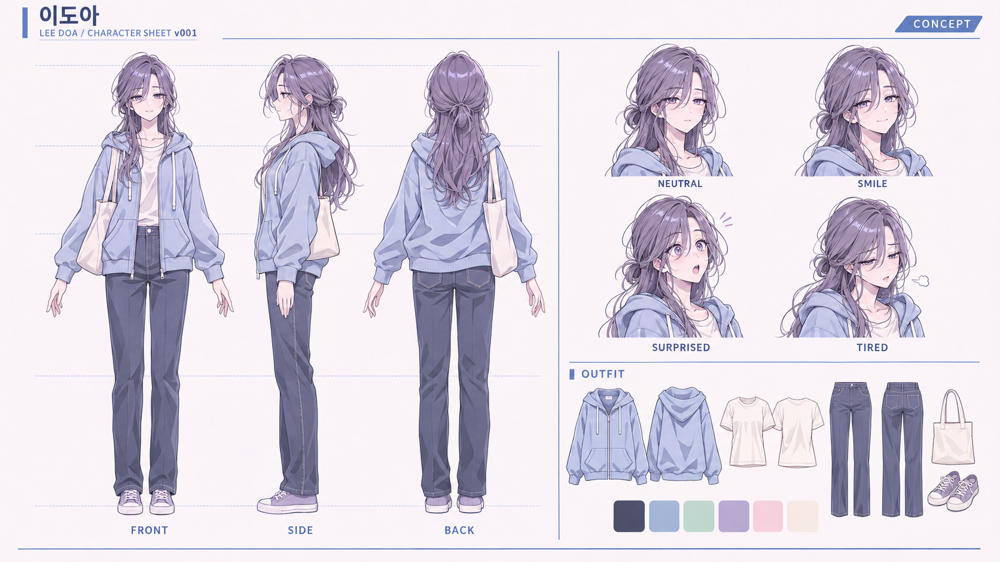

# 이도아 캐릭터 시트 v001

작성일 2026-11-25 · 성인 여성 25세 · 야간 근무를 마친 방송 스태프 · 외형 검토 후보

현재 MVP 편의점의 손님으로 등장한다. 윤서하 시트는 선화·셀 채색·시트 구성 참고이며, 새 인물의 얼굴·헤어·의상을 별도로 설계했다. 나이·이름·세부 외형은 이번 사용자 방향에 맞춘 제작안이다.

외형 요청 원문: A softly pretty sleepy adult night-shift production staff woman with long muted lavender-gray hair half tied loosely at the nape, wispy side-swept bangs, gentle muted violet eyes. Powder-blue relaxed hoodie over an ivory top, straight charcoal-blue jeans, lavender-gray canvas sneakers, a plain soft off-white tote bag. Slim adult 6.5-7 head proportions. Small weary kind smile, faint under-eye tiredness, no headphones, no logo.

정면·측면·후면 전신, 기본·웃음·놀람·피곤 표정, 의상 구조와 색상표를 포함한다. 뒷모습과 소품 세부는 새 디자인 제안이다.

- 시트: ART-0006, 실제 1672×941 불투명 PNG.
- 게임용 이미지: [lee_doa](../../Assets/Art/Characters/Customers/chr_lee_doa_customer_v001.png), ART-0018, 실제 1086×1448 투명 PNG.
- 기록: [시트 프롬프트](../../ThirdParty/Generated/ART-0006/prompt.txt), [게임용 제작 기록](../../ThirdParty/Generated/ART-0018/provenance.json).

최초 출력은 확대·크롭 없이 보관한다. 게임용 파일은 시트의 작은 그림을 확대한 결과가 아닌 별도 참조 생성물이다. 최종 외형 승인과 Steam 출시 권리 확인은 별도다.
