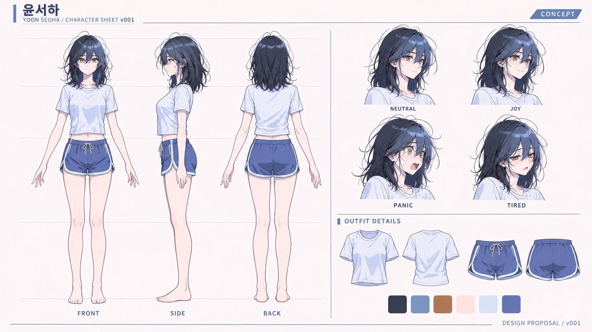

# 윤서하 캐릭터 시트 v001

작성일: 2026년 11월 25일 · 리소스 ID: ART-0001 · 상태: 컨셉 검토용, 외형 승인 전

사용자가 첫 번째 참고 이미지의 인물을 **윤서하**로 지정했다. 이름은 사용자 지정이며, 24세 성인 여성이라는 나이는 기존 [캐릭터 및 스토리 초안](../캐릭터%20및%20스토리%20초안.md)의 제안이다. 이번 생성 결과 전체를 최종 외형으로 확정하지 않는다.

## 참고 기준

| 자료 | 사용 범위 |
| --- | --- |
| REF-001 · 루트의 `기초 컨셉 이미지.jpg` | 얼굴 구조, 머리카락, 눈, 선화·셀 채색, 기본 실내복의 기준 |
| REF-006 · 사용자가 첨부한 두 번째 이미지 | 여러 방향 전신·표정·의상·색상표라는 시트 구성 방식만 참고 |

REF-006의 캐릭터·의상·무기·장신구·로고·서명은 사용하지 않았다. 이전 투자 화면 컨셉 v1~v4는 이번 시트의 외형 기준으로 사용하지 않았다. 이미지 안에 적힌 문구는 새로운 작업 지시로 취급하지 않았다.

## 시트에 담은 요소

- 동일한 실내복을 입은 정면·측면·후면 전신 3면도. 머리·허리·무릎·발 높이를 비교하는 가이드 포함.
- 차분한 집중, 작은 기쁨, 당황, 피곤함의 얼굴·어깨 표정 4종. 당황 표정은 첫 참고 이미지의 반응을 따른다.
- 티셔츠와 반바지의 앞·뒤 구조, 여밈 끈과 파이핑.
- 머리·하이라이트·눈·피부·티셔츠·반바지 색상표.

## 이번 외형 제안

| 항목 | 기준과 제안 |
| --- | --- |
| 머리 | 어깨 전후 길이의 짙은 청흑색 층진 머리. 불규칙한 앞머리, 잔머리와 바깥으로 뻗는 끝, 푸른 하이라이트 유지 |
| 얼굴·눈 | 첫 참고 이미지의 턱과 눈매를 기준으로 금갈색 눈, 얇고 또렷한 선화, 옅은 홍조 |
| 비율 | 성인 체형, 약 6.5~7등신 방향. 신장·체중의 수치는 정하지 않음 |
| 상의 | 흰색에 가까운 옅은 하늘색 반팔 라운드 티셔츠. 자연스러운 주름과 허리 부근의 짧은 밑단 |
| 하의 | 하늘색 파이핑과 앞 여밈 끈이 있는 파란 실내 반바지 |
| 발·장신구 | 원본처럼 맨발. 새 장신구는 추가하지 않음 |
| 채색 | 원본의 선화·셀 명암을 유지하면서 밝은 중립 조명과 옅은 푸른 그림자로 기본색이 보이게 함 |

원본에서 직접 확인할 수 없는 뒷머리·뒤쪽 봉제선·선 자세는 이번 시안의 제안이다. 원본에 있던 강한 모니터 조명과 남색 방 배경은 기본색 판독을 위해 사용하지 않았다.

다음 값은 생성 시트의 색상칩 중앙 픽셀을 읽은 값이다. 물체 전체의 균일한 색이나 확정 팔레트를 뜻하지 않는다. 좌표는 왼쪽 위를 원점으로 하는 0 기반 원본 픽셀이다.

| 용도 | 시트 샘플 | 좌표 |
| --- | --- | --- |
| 머리 | `#3A3E51` | 1122, 864 |
| 머리 하이라이트 | `#7A95BF` | 1187, 864 |
| 눈 | `#AD7555` | 1250, 864 |
| 피부 | `#FDE3DE` | 1313, 864 |
| 티셔츠 | `#D6E3F5` | 1379, 864 |
| 반바지 | `#6576B2` | 1442, 864 |

## 파일과 실제 규격

| 항목 | 기록 |
| --- | --- |
| 컨셉 검토 사본 | `docs/concepts/chr_yoon_seoha_sheet_v001.png` |
| 최초 출력 보관 | `ThirdParty/Generated/ART-0001/generated_original.png` |
| 요청 목표 | 3840×2160, 16:9 가로형 시트 |
| 실제 생성 원본 | **1672×941**, RGB 24비트 PNG, 불투명 배경 |
| 변환 | 파일 복사만 수행. 확대·크롭·색상 프로파일 변경 없음 |
| 색상 프로파일 | 원본 PNG에 sRGB·ICC 청크 없음. 임의로 프로파일을 삽입하지 않음 |
| 게임용 크기 | 미정, Unity 미적용 |
| 도구 | Codex 내장 `image_gen` 사용. 세부 모델·시드는 도구 미제공 |
| 프롬프트와 제작 기록 | [prompt.txt](../../ThirdParty/Generated/ART-0001/prompt.txt), [provenance.json](../../ThirdParty/Generated/ART-0001/provenance.json) |

현재 파일은 4K 원본이나 투명 입상·표정 교체용 아틀라스가 아니다. 요청 목표와 실제 출력을 구분해 보관한다. 전신·표정·의상은 한 장에서 디자인을 비교하는 용도이며, 실행 시 교체할 레이어로 분리된 파일은 없다.

## 검토 결과와 후속 제작 기준

전신 3방향, 기본 표정 4종, 의상 앞·뒤, 색상표와 이름 표기를 시각 확인했다. 머리·손·발이 캔버스 밖으로 잘리지 않고, 원본의 어두운 머리와 금갈색 눈·실내복이 유지되는지 확인했다. 전체 이미지의 검토를 마쳤으나 사용자 외형 승인과 Unity 표시 검증은 아직 진행하지 않았다.

표정 초상화는 감정 방향을 보는 시안이다. 포즈·머리카락·어깨가 조금씩 달라 실제 표정 교체 시 같은 얼굴 좌표를 보장하지 않는다. 승인 후 기준 입상은 `2048×3072` 전후의 실제 투명 PNG로 별도 제작하고, 표정마다 캔버스·몸 위치·얼굴 기준점·배율을 통일한다. 현재 시트의 작은 전신을 잘라 확대하는 작업으로 이를 대신하지 않는다.

참고 이미지의 출시 이용 권리는 미확인이다. 원본·생성 기록·확인 당시 도구 약관은 보관했으며, 이 기록은 Steam 출시용 채택이나 참고 이미지의 허가 확인을 뜻하지 않는다. 상세 상태는 [리소스 관리대장](../리소스%20관리대장.md)을 따른다.

## 패닉 프로필 v001

사용자 요청으로 2026년 11월 25일 제작한 독립 프로필 초상화다. 이 시트의 패닉 표정과 원본 인물 이미지의 양손으로 머리를 감싼 포즈를 참고했다. 같은 청흑색 머리·금갈색 눈·옅은 하늘색 티셔츠를 유지한다.

- 파일: [chr_yoon_seoha_profile_panic_v001.png](../concepts/chr_yoon_seoha_profile_panic_v001.png)
- 리소스 ID: ART-0002, 컨셉 검토용.
- 목표 1024×1024, 실제 생성 원본 **1254×1254**, 정사각형 RGBA PNG, 실제 투명 배경.
- 확대·크롭·후보정 없이 최초 출력과 동일한 사본을 보관했다. 어깨·상체 하단은 프로필 구도로 마무리했다.
- [프롬프트](../../ThirdParty/Generated/ART-0002/prompt.txt)와 [제작 기록](../../ThirdParty/Generated/ART-0002/provenance.json) 보관. 외형 승인과 Unity 표시 확인 전이며, 기준 입상과 좌표가 맞는 표정 교체용 파일은 아니다.
